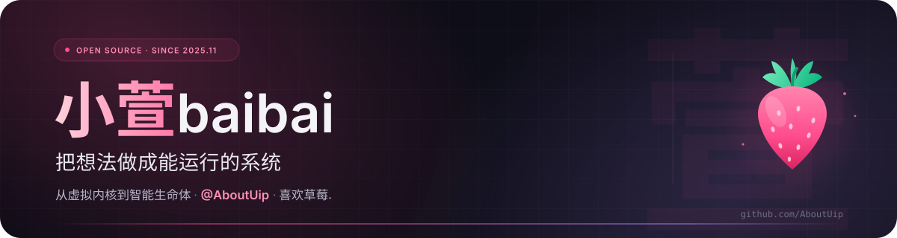
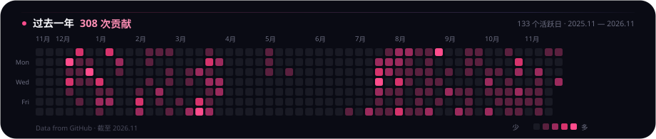

  

  
  
  

## 🍓 关于我

> 从虚拟内核到智能生命体，从自研语言到零信任通信——用代码探索系统的边界。

我是 **小萱baibai**，一名独立开发者。2025 年 11 月开始在 GitHub 上开源，喜欢把脑子里的想法一路做到能跑、能看、能用的程度，也喜欢安静、克制、不打扰人的产品。

- 🔭 **目前在做**：Agent 驱动的设计工具、跨平台音乐客户端、浏览器里的计算机
- 🌱 **正在折腾**：TypeScript 重写的 ZerOS、Java 解释器、流式协议
- 🧠 **感兴趣**：系统底层 · AI Agent · 安全通信 · 编程语言 · 独立游戏
- 🍓 **关于我**：喜欢草莓，喜欢把复杂的东西做得简单一点

## 🧭 涉猎领域

| 领域 | 在做什么 | 代表项目 |
| :--- | :--- | :--- |
| 🟢 **系统层** | 虚拟内核、流式协议、底层运行时 | [ZerOS-System](https://github.com/AboutUip/ZerOS-System) · [XAIOP](https://github.com/AboutUip/XAIOP) · [HIVE](https://github.com/AboutUip/HIVE) |
| 🔵 **安全层** | 零信任通信、内网安全、数据销毁 | [ZeroTrustChat](https://github.com/AboutUip/ZeroTrustChat) |
| 🟣 **智能层** | LLM 集成、Agent 编排、桌面生命体 | [SAX-RAG](https://github.com/AboutUip/SAX-RAG) · [AgentToolkit](https://github.com/AboutUip/AgentToolkit) · [DigitalLife](https://github.com/AboutUip/DigitalLife) |
| 🟡 **语言层** | 编程语言设计、解释器、跨范式 | [ObjectiveR](https://github.com/AboutUip/ObjectiveR) |
| 🔴 **产品层** | 跨平台客户端、媒体工具、用户体验 | [ZMusic](https://github.com/AboutUip/ZMusic) |
| 🌸 **创意层** | 独立游戏、互动叙事、情感设计 | [MirrorWithin](https://github.com/AboutUip/MirrorWithin) |

## 🚀 精选项目

- 🎧 **[ZMusic](https://github.com/AboutUip/ZMusic)** — 把世界调小一点，把歌开大一点。一张封面、一行歌词、一整段属于你的时间。  
  `Kotlin` · `Jetpack Compose` · `Media3` · Android / Windows / Linux

- 🖥️ **[ZerOS-System](https://github.com/AboutUip/ZerOS-System)** — 在浏览器沙箱里建一台计算机：进程、文件系统、窗口管理与应用生态，一个教学向的虚拟内核。  
  `JavaScript` · `HTML5` · `SVG` · `Browser API`

- 🔐 **[ZeroTrustChat](https://github.com/AboutUip/ZeroTrustChat)** — 专为内网设计的数据安全 IM，核心原则是「宁销毁不留痕」。  
  `C++` · `Zero Trust` · `IM Protocol` · `Apache-2.0`

- 🧠 **[ObjectiveR](https://github.com/AboutUip/ObjectiveR)** — 自研解释型强类型语言 Obr，支持面向对象、过程式与函数式，从词法分析一路做到运行时。  
  `Java` · `Interpreter` · `Multi-paradigm`

- 🧩 **[SAX-RAG](https://github.com/AboutUip/SAX-RAG)** — 面向私有垂直知识库的无 LLM 检索默认合同：双通道召回、ACL 前置过滤、决策可复现。  
  `Python` · `Information Retrieval` · `ACL`

- 🔌 **[XAIOP](https://github.com/AboutUip/XAIOP)** — 流式、面向行的光标构造线协议，让程序以确定性方式物化 JSON。  
  `Java` · `Streaming` · `JSON`

## 📈 GitHub

  

  主要语言：Java · TypeScript · Kotlin · Python · Go · C / C++

## 🛠 技术栈

**语言**

**框架与平台**

**工具**

## 🌱 最近在做

- **[Morfa](https://github.com/AboutUip/Morfa)** — AI 原生的在线 UI 设计平台：Agent 负责理解与执行，用户始终保留预览、应用与撤销的控制权。
- **[ZerOS-System-Pro](https://github.com/AboutUip/ZerOS-System-Pro)** — 用 TypeScript 重写 ZerOS，把虚拟硬件、操作系统与编程语言一起放进浏览器沙箱。
- **[Conductor](https://github.com/AboutUip/Conductor)** — 统一协调、调度并观测异步工作的 TypeScript 运行时。
- **[ZMusic](https://github.com/AboutUip/ZMusic)** — 继续补齐 Windows / Linux 端，与 Android 的播放语义和接口行为保持对齐。

## 💬 找到我

- **GitHub** — [@AboutUip](https://github.com/AboutUip)
- **Email** — [18234679734@163.com](mailto:18234679734@163.com)
- **想聊什么** — 系统底层、AI Agent、编程语言、独立产品，或者只是来打个招呼。

> 如果你也在把某个想法做成能运行的系统，欢迎一起聊聊。

---

  把世界调小一点，把代码写大一点。🍓 
  © 2025–2026 小萱baibai · Built with curiosity

